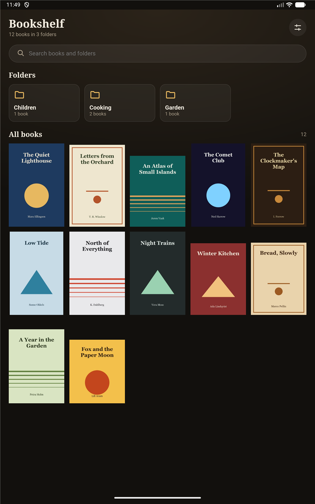
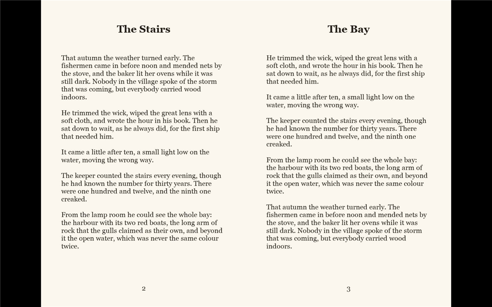
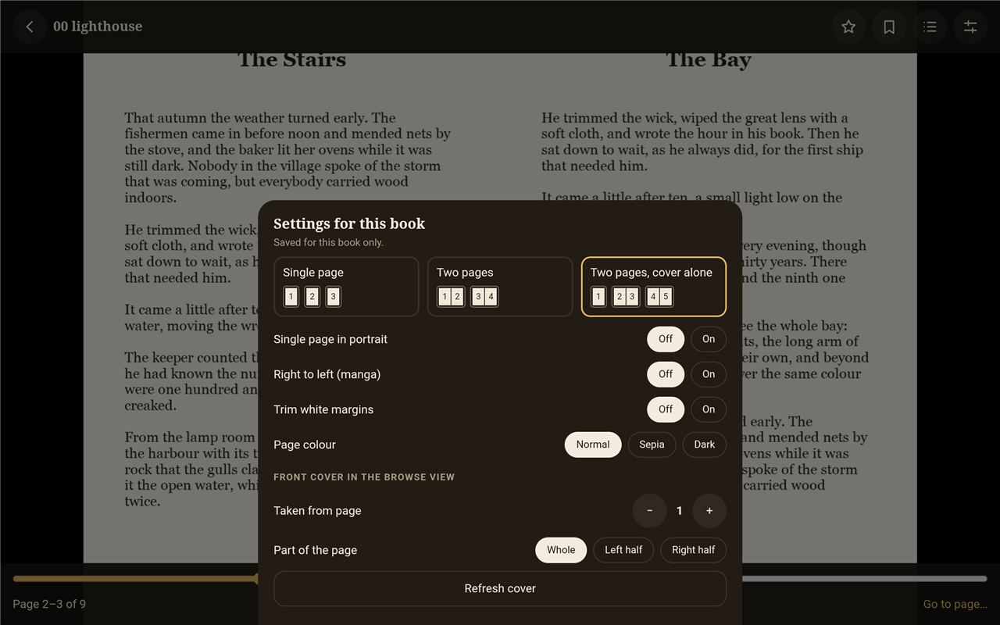

# Bookshelf

An app for browsing and reading your own PDF books, made for a tablet.
The books stay on your device; nothing is uploaded.

### [⬇ Download the Android app](https://github.com/neckfors/bookshelf/releases/latest)

For Android 8 or newer; see [how to install it](#android-app). It is recommended on Android, as it
gets at the files faster.

There is also a [web app](https://neckfors.github.io/bookshelf/) with the same screens and features,
to install from the browser.







## Browsing
- Front covers only, with nothing around them. Each takes an equally sized space and is shown whole, in
  its own shape. White scan borders are trimmed. A book with a blank, locked or broken first page gets
  a title cover.
- Folders with book counts, favorite folders and favorite books. A folder holds only the books directly
  in it. Every folder with books of its own is listed on the home screen, however deep it is, with the
  folders it lies in shown beside the count; folders without books of their own are not listed.
- Search in file and folder names (accents don't matter), everywhere or in the open folder.
- 2 to 10 columns, set separately for portrait and landscape (a phone starts with fewer than a tablet).
- Covers are saved, so the library opens at once. New, changed and removed files are noticed
  automatically (by size and date). You can also refresh all covers.
- Covers are drawn with PDFium (the engine in Chrome's own PDF viewer), which goes straight to the
  front page and reads only a few small parts of each file. A scanned front page (one JPEG picture) is
  handed to the browser's own, much faster picture decoder.
- Getting data from a file is the slow part on Android, and reads are handled one after another there.
  So the app makes as few reads as it can and only keeps 4 books on the way, which lets the work follow
  your scrolling quickly.
  The start and end of each file are read in advance, so often little more is needed.
  Up to 4 background workers turn the data into finished tiles, without holding up scrolling.
- Books are listed from their file names first, so they appear right away; checking for changed files
  happens afterwards. Covers are made once all books are listed, in the order you look at them:
  the ones on screen from the top, then the ones below. They also appear in that order (one that is
  slow holds back the next ones for at most 1.5 s). Scroll further and the work moves with you.
  Settings shows how long finding books, making covers and opening a book took, step by step.
  **Test file speed** measures how fast the device hands over files and gives a report you can copy.

## Reading
- Fullscreen, portrait and landscape. Swipe or tap the sides to turn; tap the middle for the menu.
- Pinch to zoom. While zoomed, drag to move around.
- Settings saved per book: single page, two pages, or two pages with the cover alone (default);
  single page in portrait; right to left; trim white margins; normal, sepia or dark pages;
  which page (and which half) is the cover.
- Bookmarks, table of contents, page slider and "Go to page".
- A picture of the page you left (or the cover) shows at once while the book opens, and the last
  book you closed reopens instantly.
- A book opens where you left it. If the last page was showing when you left, it starts from the beginning.
  Turning past the last page closes the book.

## Using the web app
Open the app in Chrome, install it from the browser menu, then tap **Choose folder** and pick the
folder with your PDFs (subfolders are included). If Chrome asks for access again later, tap **Allow**.

The app must be served over HTTPS (or from `localhost`). The first start needs a network connection to
fetch [pdf.js](https://mozilla.github.io/pdf.js/) (for reading) and
[PDFium](https://www.npmjs.com/package/@embedpdf/pdfium) (for covers, about 5 MB) from jsDelivr; they are then
saved on the device.
Settings and favorites are stored in the browser, so clearing the site's data removes them.

## Files
| File | Contents |
| --- | --- |
| `js/app.js` | Browse view, folders, favorites, search |
| `js/reader.js`, `js/gestures.js` | Reader and touch handling |
| `js/library.js` | Folder scanning and the cover queue |
| `js/covers.js`, `js/coverworker.js`, `js/scan.js`, `js/tile.js` | Making covers: fetching, drawing, scanned pictures, tiles |
| `js/speedtest.js` | File speed test (web app only) |
| `js/native.js` | What differs in the Android app: folder access, front pages, full screen |
| `js/db.js`, `js/pdf.js`, `js/update.js`, `js/util.js` | Storage, PDF loading, updates, helpers |
| `sw.js` | Offline use. Raise `VERSION` for each release; the Android app takes its version from it |
| `android/` | The Android app. The web files are copied into it when it is built |
| `release.ps1`, `version.json` | Publishing an Android release; `version.json` is made by the first one |

To run it locally: `py -3 -m http.server 8123`, then open `http://localhost:8123`.

## Android app
For Android 8 or newer. It shows the same pages as the web app, from inside the APK, so the two stay alike.
Android gets at the book folder and draws the pages itself, both the front pages and the pages you read,
so books open quickly.

**Install:** download the APK from the [newest release](https://github.com/neckfors/bookshelf/releases/latest),
open it, and allow your browser or file manager to install apps when asked. Then tap **Choose folder**.
Android doesn't allow choosing the Download folder itself, only folders inside it.

- Favorites, layouts, bookmarks and reading positions from the web app are not carried over.
- The table of contents is read with pdf.js, fetched from jsDelivr the first time it is needed (this
  needs a network connection) and then kept. Everything else works offline from the start.
- Reading is full screen and keeps the screen on. **Back** closes an open sheet or book.
- **Updates:** the app compares itself with `version.json` here on GitHub when you return to it and every
  30 minutes, or when you tap **Check for updates** in Settings. When there is a new version, a bar appears above the library (not over an open book), and its **Update** button opens the download page. Install the
  new APK over the old one; your settings stay.
- It asks for network access only (for pdf.js and the update check). It can only read the folder you choose.

**Build** with Android Studio's Java:

```powershell
$env:JAVA_HOME = 'C:\Program Files\Android\Android Studio\jbr'; .\android\gradlew.bat -p android assembleRelease
```

The APK ends up in `android/app/build/outputs/apk/release/`. It is signed with the building computer's
debug key, and an update only installs over an app signed with the same key.

**Release:** raise `VERSION` in `sw.js`, commit and push, then run `.\release.ps1`.

## Support

If you like the app, you can support the author on [PayPal](https://paypal.me/neckfors). Thank you!
